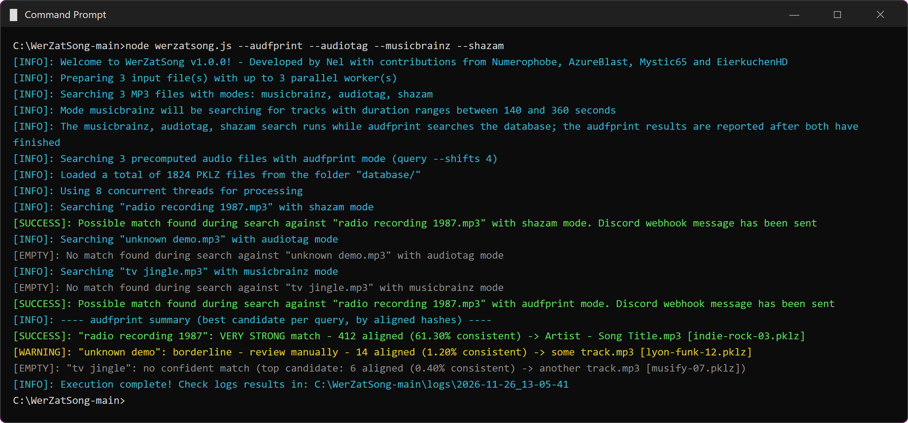
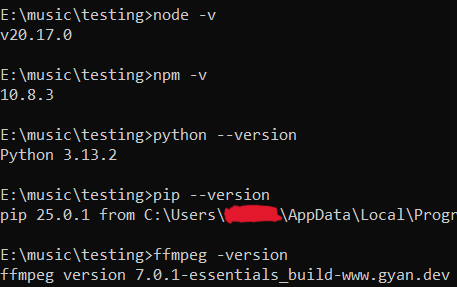
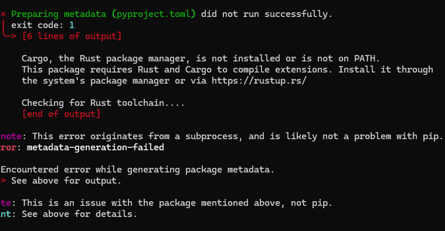
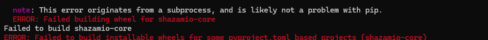
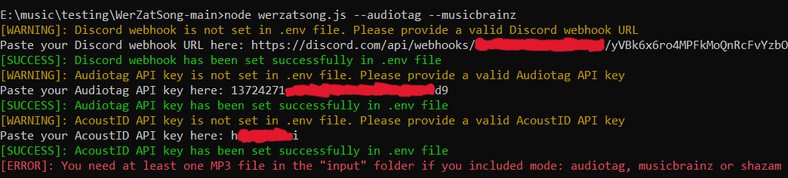
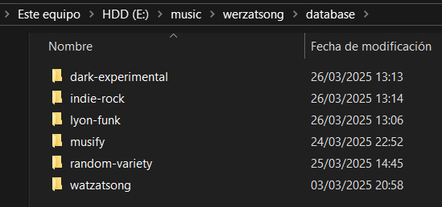

<div align="center">

# WerZatSong

**Find out the name of a song when all you have is a recording of it.**

[](https://github.com/Nel80s/WerZatSong/stargazers)
[](https://github.com/Nel80s/WerZatSong/network/members)
[](https://github.com/Nel80s/WerZatSong/commits/main)
[](https://github.com/Nel80s/WerZatSong/commits/main)

[](https://github.com/Nel80s/WerZatSong/issues)
[](LICENSE)


<br>



</div>

---

Put your recordings into a folder, type one command, and WerZatSong searches for each song in up to four ways. What it finds is posted to a Discord channel of your choice and saved as text files on your computer.

| Search | How it searches | Needs |
|---|---|---|
| **Audfprint** | Compares your songs with a large collection of song fingerprints, on your own computer | The fingerprint database |
| **Audiotag** | Online, at audiotag.info | A free Audiotag key |
| **MusicBrainz** | Online, in the AcoustID / MusicBrainz database | A free AcoustID key |
| **Shazam** | Online, with Shazam | Nothing extra |

You can use one search or several at once. Audfprint runs entirely on your computer; the other three send your recordings, or fingerprints made from them, to those online services. The setup is done once and is written for Windows.

---

## Contents

- [Setup](#setup)
- [Searching for songs](#searching-for-songs)
- [Understanding the results](#understanding-the-results)
- [All options](#all-options)
- [The settings file (.env)](#the-settings-file-env)
- [Updating WerZatSong](#updating-werzatsong)
- [When something goes wrong](#when-something-goes-wrong)
- [Credits](#credits)

---

## Setup

### 1. Install Node.js, Python and FFmpeg

WerZatSong needs three free programs:

| Program | What it's for |
|---|---|
| [**Node.js**](https://nodejs.org) 20 or newer (the **LTS** version) | Runs WerZatSong itself |
| [**Python**](https://www.python.org/downloads) 3.13 or newer | Runs the fingerprinting and the Shazam search |
| [**FFmpeg**](https://www.gyan.dev/ffmpeg/builds) | Reads and cuts audio files |

The easiest way is to open **Command Prompt** (press the Windows key, type `cmd`, press Enter) and type these one at a time:

```
winget install OpenJS.NodeJS.LTS
winget install Python.Python.3.13
winget install Gyan.FFmpeg
```

<details>
<summary><b>Installing them by hand instead</b></summary>

<br>

Download each program from the links above. In the Python installer, tick **"Add python.exe to PATH"** on the first screen. FFmpeg comes as a ZIP file without an installer: unzip it somewhere permanent (for example `C:\ffmpeg`) and add its `bin` folder to PATH:

1. Press the Windows key, type **environment variables** and open **Edit the system environment variables**.
2. Click **Environment Variables...**, select **Path** in the upper list and click **Edit...**.
3. Click **New**, type the path of the `bin` folder (for example `C:\ffmpeg\bin`) and click **OK** in every window.

</details>

Then open a **new** Command Prompt window and type these one at a time. Each should print a version number:

```
node -v
npm -v
python --version
pip --version
ffmpeg -version
```



If one says *"is not recognized as an internal or external command"*, Windows can't find that program (it isn't on its "PATH"). Install it again and open a new Command Prompt window.

### 2. Download and install WerZatSong

1. On this page, click the green **<> Code** button → **Download ZIP**, and unzip it to a folder of your choice, for example `C:\WerZatSong-main`. *(If you know Git, `git clone https://github.com/Nel80s/WerZatSong.git` makes [updating](#updating-werzatsong) easier.)*
2. Open the folder in File Explorer, click in the address bar at the top, type `cmd` and press Enter. A Command Prompt window opens in that folder. All commands from here on are typed there.
3. Type these one at a time:

   ```
   npm install
   pip install -r requirements.txt
   pip install audioop-lts
   pip install shazamio
   ```

<details>
<summary><b>One of the <code>pip install</code> commands failed?</b></summary>

<br>

It is usually one of these two:

**An error that mentions Rust.** Install Rust from [rust-lang.org](https://www.rust-lang.org/tools/install), check it with `rustc --version` in a new Command Prompt window, and run the `pip install` commands again.



**An error that mentions Microsoft Visual C++ or build tools.** Install the [Build Tools for Visual Studio](https://visualstudio.microsoft.com/visual-cpp-build-tools/) and tick **"Desktop development with C++"** in the installer. Restart the computer and run the `pip install` commands again.



</details>

### 3. Get a Discord webhook and your keys

**A Discord webhook** is a private address that lets WerZatSong post in one channel of your server:

1. In Discord, create your own server if you don't have one (the **+** at the bottom of the server list).
2. Next to a text channel, click the gear icon (**Edit Channel**) → **Integrations** → **Webhooks** → **New Webhook**.
3. Click the new webhook, then **Copy Webhook URL**.

**An Audiotag key** (only for the Audiotag search): create a free account at [audiotag.info](https://audiotag.info), open the [user section](https://user.audiotag.info) → **API keys** → **Create new API key**, and copy the key.

**An AcoustID key** (only for the MusicBrainz search): create a free account at [acoustid.org](https://acoustid.org), open [My Applications](https://acoustid.org/my-applications) → **Register a new application**, fill in the fields with anything, click **Register** and copy the **API key**.

### 4. First start

Type:

```
node werzatsong.js --audiotag --musicbrainz
```

WerZatSong creates the folders it needs (`input`, `database`, `logs` and a few working folders) and its [settings file](#the-settings-file-env), and asks you to paste the webhook URL and the two keys (right-click pastes in Command Prompt). It posts a welcome message to your Discord channel to check the webhook, and then stops because the `input` folder is still empty. That is expected.



### 5. Add the fingerprint database

Only needed for the Audfprint search. Download the database folders from [wzs.cosine.club](https://wzs.cosine.club) and put them, as they are, into the `database` folder (the files inside end in `.pklz`). The database takes a lot of disk space and is read completely on every Audfprint search, so it is much faster on an SSD than on an external or older hard drive.



---

## Searching for songs

1. **Put your songs into the `input` folder**: up to **30 MP3 files** per search. Other formats are ignored, so convert them first: typing `ffmpeg -i "my song.flac" "my song.mp3"` in Command Prompt (in the folder where the file is) makes an MP3 copy of any audio file. Simple file names work best.

2. **Start the search** with the searches you want, for example all four:

   ```
   node werzatsong.js --audfprint --audiotag --musicbrainz --shazam
   ```

3. **Wait until it says "Execution complete!"** Closing the window stops the search. The online searches post as soon as they find something; Audfprint takes the longest and posts at the end. A MusicBrainz search takes about five minutes per song, because the AcoustID service only answers a few questions per second.

> [!NOTE]
> Don't click inside the Command Prompt window while it runs: Windows pauses the program while text is selected there. If it seems stuck, press **Esc**.

4. **Empty the `input` folder** before the next batch. WerZatSong leaves your files there, and the next search would search them again.

---

## Understanding the results

For every song, each search posts one message to Discord: what it found, or "no match found". If Audfprint finds more matches than fit into one message, the full list is attached as a `.txt` file.

Every search also gets its own folder inside `logs`, named after the date and time it started (in UTC, so the hour may differ from your clock), with one text file per song and search, for example `my song.audfprint.txt`. The Audfprint file explains every column at the top and lists all candidates, the most likely first.

### Audfprint labels

| Label | Meaning | Posted to Discord |
|---|---|---|
| **VERY STRONG** | Almost certainly the same recording | Yes |
| **STRONG** | Very likely the same recording | Yes |
| **PROBABLE** | Likely, but worth listening to | Yes |
| **BORDERLINE** | Could be chance; worth a listen only if nothing better was found | No, log file only |
| **NO MATCH** | Below every threshold | No, log file only |

Each match also shows two numbers:

- **aligned**: how many small pieces of sound (fingerprint "hashes") matched *at the same moments* in both recordings. 15 or more usually means a real match.
- **%** (consistency): the share of all matching pieces that line up in time. Chance alone stays below about 1%; matches below 2% are never posted.

> [!IMPORTANT]
> Always listen before you trust a result, especially a PROBABLE one.

---

## All options

Options go after `node werzatsong.js`. `node werzatsong.js --help` lists them all.

| Option | What it does | Default |
|---|---|---|
| `--audfprint`, `--audiotag`, `--musicbrainz`, `--shazam` | Choose the searches (at least one) | |
| `--trim <seconds>` | Uses only the first part of each song, for example `--trim 60`. Makes long recordings faster to search. | the whole song |
| **Audfprint** | | |
| `--folder <name>` | Searches only one folder inside `database`, for example `--folder "indie-rock"` | the whole database |
| `--threads <number>` | How many database files are searched at the same time (at most 16; fewer when memory is short) | the computer's processor threads |
| `--shifts <1–8>` | How carefully your songs are fingerprinted. Higher finds more but is slower. | 4 |
| `--shard-timeout <minutes>` | How long one database file may take before it is skipped and reported | 15 |
| `--resume` | Continues a stopped search, see below | |
| `--merge <folder>` | Database maintenance, see below | |
| **MusicBrainz** | | |
| `--duration <min:max>` | Song lengths in seconds to look for (30 to 600). For a short song try `"30:200"`, for a long one `"300:600"`. | `"140:360"` |
| `--extension <seconds>` | Adds this many seconds before the song is fingerprinted; can help when the recording starts late (1 to 25) | 10 |

### Continuing a stopped search: `--resume`

If an Audfprint search stops before it is finished (the window was closed, the computer restarted, it crashed), type:

```
node werzatsong.js --audfprint --resume
```

It searches only the database files that were not finished, keeps what was found before, and reports everything as usual. It only works if you haven't started another search in between: a new search replaces what `--resume` needs.

### Faster Audfprint searches

- `pip install isal` makes reading the database about three times faster. It is used by itself once installed.
- `--folder` searches one part of the database instead of all of it, and `--shifts 2` fingerprints your songs more quickly.
- `--merge <folder>` combines the many small `.pklz` files of a database folder into a few large ones, in a new folder `<folder>__merged`, which can be much faster on a hard drive. It only merges and then stops. Searches of the whole database keep using the originals; search the merged copy with `--folder "<folder>__merged"`. `--shard-files <number>` (default 64) sets how many files go into each merged file, and `--max-dropped <percent>` (default 3) discards a merged file that would lose more than that share of its fingerprints.
- More switches are in the [settings file](#the-settings-file-env).

---

## The settings file (.env)

WerZatSong keeps its settings in the file `.env` in its folder. Open it with Notepad (right-click → **Open with** → **Notepad**); each line is `NAME=value`.

| Setting | What it is |
|---|---|
| `WEBHOOK_URL` | The Discord webhook the results are posted to |
| `AUDIOTAG_KEY` | Your Audiotag key |
| `ACOUSTID_KEY` | Your AcoustID key; several keys can be separated by commas |
| `NODE_COMMAND`, `PYTHON_COMMAND`, `FFMPEG_COMMAND` | How Node.js, Python and FFmpeg are started (normally `node`, `python`, `ffmpeg`). For a program that isn't on PATH, put its full path, for example `C:\ffmpeg\bin\ffmpeg.exe`. |
| `DISK_PRIORITY=normal` | *Optional, Windows only:* reads the database at full speed even when WerZatSong was started by a program running it in the background at low priority |
| `SEQUENTIAL_MODES=on` | *Optional:* runs the online searches first and Audfprint after them, instead of at the same time |
| `FAST_INFLATE=off` | *Optional:* doesn't use isal even when it is installed |
| `VERIFY_CHECKSUMS=always` | *Optional:* checks every database file for damage on every search. Without it (and without isal), each file is checked the first time it is read and about once a month after that. |

> [!CAUTION]
> The `.env` file contains your keys and your webhook. Never share it: anyone with the webhook address can post in your channel.

---

## Updating WerZatSong

1. Download the new version as a ZIP.
2. In your WerZatSong folder, **keep** `.env`, `database`, `logs` and `cache`, and **replace everything else** with the new files. Never replace only some files: a mix of old and new files leads to confusing errors that look like bugs.
3. Type `npm install` and `pip install -r requirements.txt` again.

With Git, step 1 and 2 are just `git pull` in the WerZatSong folder.

---

## When something goes wrong

<details>
<summary><b>"... is not recognized as an internal or external command"</b></summary>

<br>

Windows can't find that program. See [step 1 of the setup](#1-install-nodejs-python-and-ffmpeg), then open a new Command Prompt window.

</details>

<details>
<summary><b>"Too many MP3 files! Limit per each search is 30 files..."</b></summary>

<br>

Search the rest in a second batch. The limit is there because everything an Audfprint search finds is kept in memory until the end, and that grows with every song: hundreds of songs at once can run out of memory ("JavaScript heap out of memory") and lose the whole search.

</details>

<details>
<summary><b>"... is already using this WerZatSong install"</b></summary>

<br>

Another search is still running from the same folder, maybe in another window. Wait for it to finish.

</details>

<details>
<summary><b>"invalid" webhook URL or API key</b></summary>

<br>

Copy it again from Discord or the website, without spaces. A webhook URL starts with `https://discord.com/api/webhooks/`. Keys already saved can be fixed in the [settings file](#the-settings-file-env).

</details>

<details>
<summary><b>Nothing arrives in Discord</b></summary>

<br>

Check `WEBHOOK_URL` in the [settings file](#the-settings-file-env). If the webhook was deleted in Discord, make a new one.

</details>

<details>
<summary><b>A file "is too short to be precomputed" or was skipped</b></summary>

<br>

The recording is too short or almost silent for a fingerprint. The other files are still searched.

</details>

<details>
<summary><b>"Nothing to resume"</b></summary>

<br>

There is no stopped search to continue (see [`--resume`](#continuing-a-stopped-search---resume)). Start a normal search.

</details>

**Anything else:** please [report it](https://github.com/Nel80s/WerZatSong/issues/new/choose) with the bug report form, and include everything the Command Prompt window showed. Command Prompt may cut off the start of a long output; to keep all of it, add `> output.txt 2>&1` to the end of the command and attach the `output.txt` file it creates.

---

## Credits

Developed by **Nel** with contributions from **Numerophobe**, **AzureBlast**, **Mystic65**, **EierkuchenHD** and **some random account**.

## License

WerZatSong is released under the [MIT License](LICENSE). The bundled programs in `libs` keep their own licenses: audfprint (`libs/audfprint`) by Dan Ellis, and fpcalc (`libs/fpcalc`) from the Chromaprint project.
